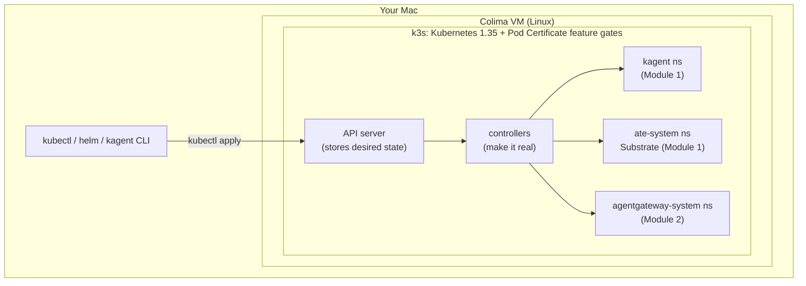
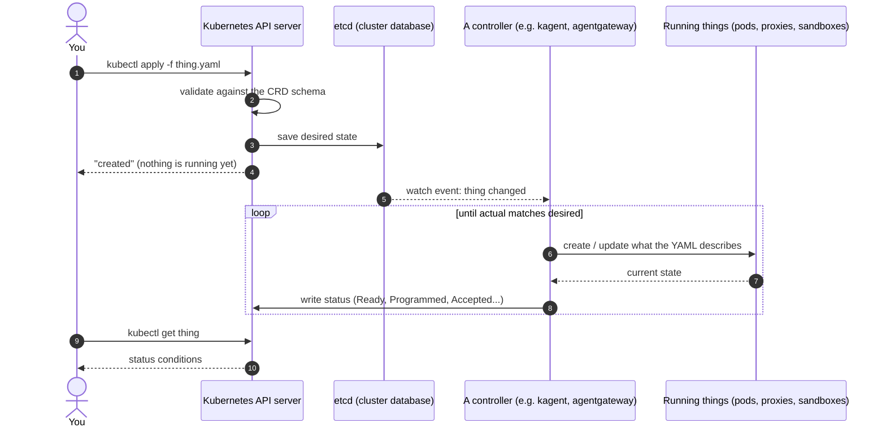

# Module 0: A local Kubernetes cluster with Colima

**Solo lab:** Basics of Kubernetes Gateway API (optionally: Exploring HTTPRoute configurations).

**Script:** `scripts/00-cluster-up.sh`

## Why this module matters

Everything else runs on this cluster, and kagent 1.0 needs two things a default local cluster doesn't
have: Kubernetes 1.35 or later, and Pod Certificates turned on. Getting them right here avoids the hardest
errors later. The one idea to take away: **Kubernetes is a database of desired state plus controllers that
act on it.** Everything in later modules is more resources and more controllers.

## How it fits together

| Layer | What it is | Why it's here |
|---|---|---|
| Your Mac | Runs Colima, `kubectl`, `helm` | Where you type commands |
| Colima VM | A small Linux virtual machine (6 CPU, 12 GB by default) | Kubernetes needs Linux; macOS can't run it directly |
| k3s | A lightweight Kubernetes distribution inside the VM, version 1.35 | One-binary Kubernetes; Colima starts it with `--kubernetes` |
| Feature gates | `PodCertificateRequest`, `ClusterTrustBundle`, `ClusterTrustBundleProjection`, plus the `certificates.k8s.io/v1beta1` API | Substrate (Module 1) gives every agent sandbox a certificate identity this way |
| Gateway API CRDs | New resource kinds: `Gateway`, `HTTPRoute`, ... | agentgateway (Module 2) is built on them |



## Step 1: Create the cluster

```bash
./scripts/00-cluster-up.sh
```

What it does and why:

1. **Starts a dedicated Colima profile** (`agents`) with k3s v1.35. A separate profile keeps this lab away
   from any other Docker or Kubernetes work.
2. **Passes feature-gate flags to k3s** for the API server, controller manager and kubelet, and turns on
   the `certificates.k8s.io/v1beta1` API. These only apply when a cluster is created, so a cluster made
   without them must be torn down and recreated.
3. **Checks that the Pod Certificates API is enabled** and warns if not.
4. **Installs the Gateway API CRDs.**

## Step 2: Look around

```bash
kubectl get nodes                                       # one node: the Colima VM
kubectl api-resources --api-group=certificates.k8s.io   # should list podcertificaterequests
kubectl api-resources | grep gateway.networking         # new kinds the CRDs added
kubectl explain gateway.spec.listeners                  # read a schema, like built-in docs
kubectl get gatewayclass                                # empty: nothing acts on Gateways yet
```

That empty `gatewayclass` list is the key lesson. The CRDs taught Kubernetes what a Gateway **is**, but
nothing **acts** on one until a controller is installed. In Module 2, agentgateway becomes that controller.

### What happens when you `kubectl apply`

Every later module follows this pattern: kagent's controller and agentgateway's controller are just more
loops like this one.



That's why `kubectl apply` returns immediately and you then **watch status** (`-w`, conditions). The
YAML is a request; the status says whether it was carried out.

## Why Colima k3s instead of kind

Upstream kagent and agentgateway docs assume kind. Colima's k3s is one VM and one command. Wherever the
docs say `kind create cluster` or `cloud-provider-kind`, skip that step, and use `kubectl port-forward`
to reach services.

## Troubleshooting

| Symptom | Cause | Fix |
|---|---|---|
| Script warns "podcertificaterequests API not found" | Cluster created earlier without the gates | `./scripts/teardown.sh`, then rerun |
| Traefik pods running | Colima default changed or overridden | It may hold ports 80/443; disable it or tear down and recreate |
| Pods `Pending` later on | VM too small | Raise `COLIMA_CPU` / `COLIMA_MEMORY` in `.env`, recreate |

## Reset

`./scripts/teardown.sh` deletes the profile. It's the fastest way to rerun everything cleanly.
