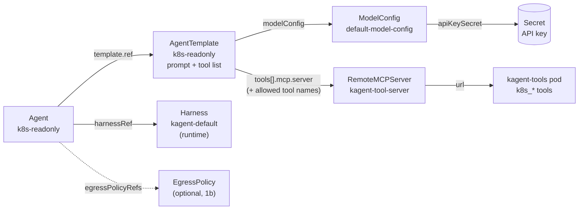
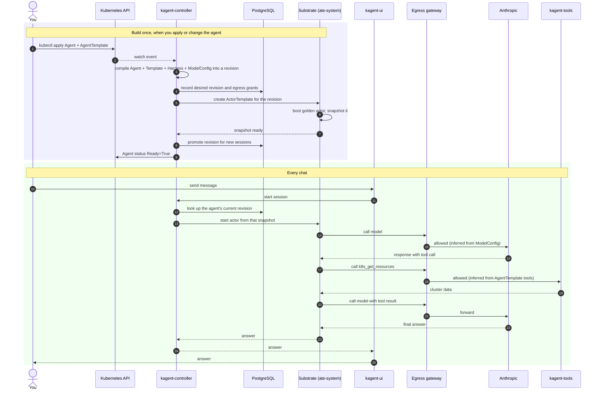
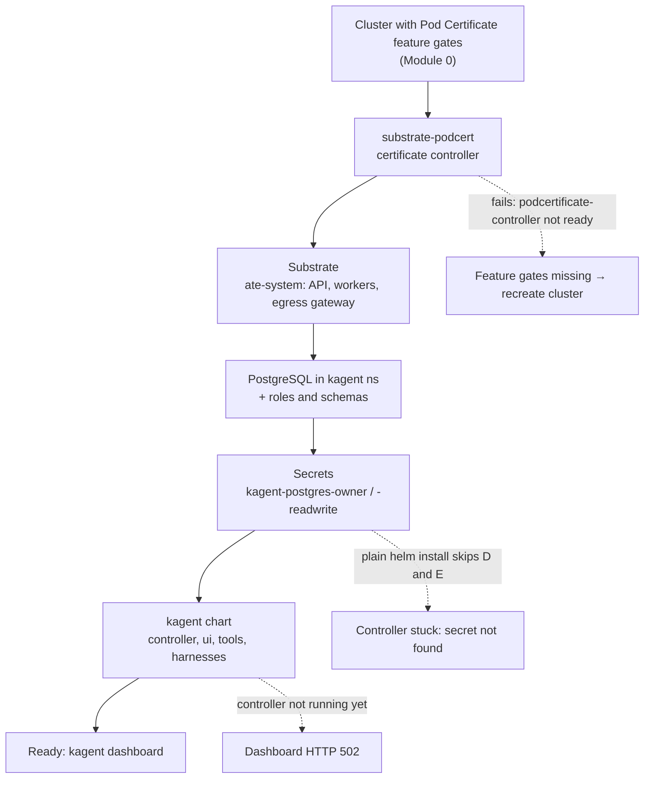
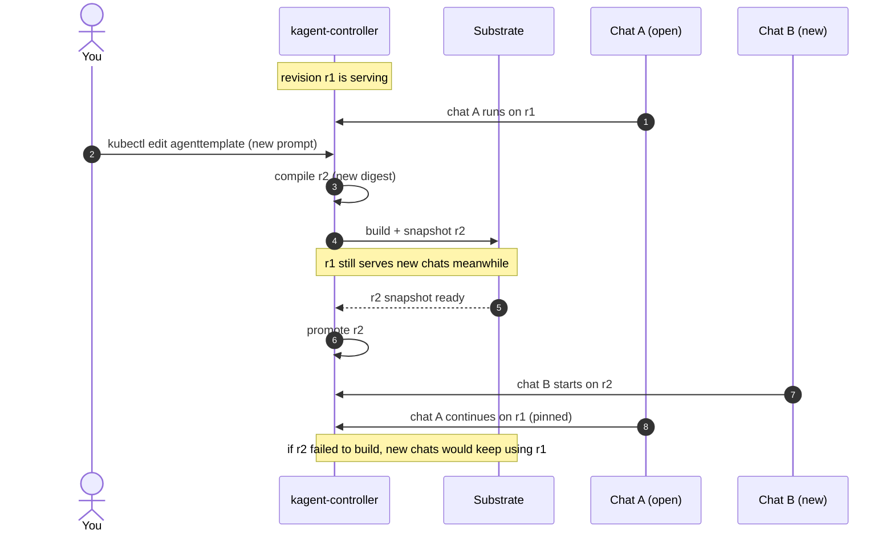

# Module 1: First agent with kagent 1.0

**Solo labs:** Building an AI agent with kagent; Implement AgentOps with kagent.
These labs predate kagent 1.0. The ideas carry over, but the resources and runtime model below are newer.

**Script:** `scripts/01-install-kagent.sh` (needs `ANTHROPIC_API_KEY` in `.env`)
**Manifest:** `manifests/lab-a/k8s-readonly.yaml`

## The mental model

kagent 0.x: an agent was a Deployment.
kagent 1.0: **an agent is a compiled, snapshotted sandbox template.** Sessions start from that snapshot
inside Substrate, kagent's sandbox runtime.

| Resource | Holds | Why it is separate |
|---|---|---|
| `Agent` | Which template and which harness; egress policy refs | Thin pointer, so one template can back many agents with different access |
| `AgentTemplate` | Model, system prompt, tools, skills | Reusable *behavior* |
| `Harness` | Which runtime executes it (`kagent-default`, `codex-default`, `claude-default`) | Swap runtimes without touching behavior |
| `ModelConfig` | Provider, model, reference to the key Secret | Keys never live in agent definitions |
| `RemoteMCPServer` | A tool server agents call (e.g. `kagent-tool-server`) | Tools are shared services |
| `EgressPolicy` | Extra HTTP(S) origins an agent may reach ([Module 1b](01b-egress.md)) | Network access is granted per agent, deny by default |

The chain: **Agent → AgentTemplate → ModelConfig + tools**, run by a **Harness** on **Substrate**.

One way to remember it: the AgentTemplate is the job description, the Harness is the type of worker hired,
the Agent is the hire (this job, this worker, this badge), the ModelConfig is the brain subscription, a
RemoteMCPServer is the toolbox, and an EgressPolicy is the building badge.

### How the resources connect

Arrows mean "refers to by name". The Agent is the only thing you chat with; everything else is reached
through it.



If any arrow points at something missing, the Agent reports `ResolvedRefs=False` and never becomes Ready.

### What runs them

Five components turn that YAML into running sessions. None of them is a per-agent Deployment.

| Component | Namespace | Responsible for |
|---|---|---|
| `kagent-controller` | `kagent` | Compiler and bookkeeper. Watches your YAML, compiles each Agent into a fixed revision, records it in Postgres, asks Substrate to build it, and reports `Ready`/`ResolvedRefs` on the Agent. The only component that decides egress grants. |
| PostgreSQL | `kagent` | kagent's memory: agent definitions, revisions, sessions, egress grants. New sessions start from what is recorded here, not directly from your YAML. |
| Substrate | `ate-system` | Where agents run. Boots each revision once and snapshots it; every chat session starts from that snapshot as a sandboxed actor, isolated with gVisor in worker pods. Its egress gateway enforces network policy and injects credentials. |
| `kagent-tools` | `kagent` | The pod behind `kagent-tool-server` that actually runs the `k8s_*` calls against the cluster. |
| `kagent-ui` | `kagent` | The dashboard, a front end to the controller. Shows HTTP 502 when the controller is down. |

### How a chat flows

The diagram shows both phases: building an agent once when you apply it, then every chat after that.



In words:

1. You send a message in **kagent-ui**.
2. **kagent-controller** starts a session from the agent's current revision, recorded in **PostgreSQL**.
3. **Substrate** starts a sandboxed actor from that revision's snapshot.
4. The actor calls Anthropic through the **egress gateway**. Allowed automatically, because the
   **ModelConfig** names that provider.
5. The actor calls `k8s_get_resources` on **kagent-tools**. Also allowed automatically, because the
   **AgentTemplate** lists that tool.
6. The answer returns to the UI.

This is why your agent has no Deployment of its own: Substrate runs it, and the controller keeps track of it.

## Install

kagent 1.0's Helm chart no longer deploys PostgreSQL or Substrate. The `kagent install` CLI sets up both
(Postgres in `kagent`, Substrate in `ate-system`), writes the DB secrets, then installs kagent. The script
removes an earlier Helm-only install first.

It also needs the Pod Certificate feature gates from Module 0. Substrate uses Pod Certificates to give
every sandbox an identity. Without them the install fails on `podcertificate-controller not ready`.

```bash
./scripts/01-install-kagent.sh 2>&1 | tee install.log
kagent dashboard        # or: kubectl port-forward -n kagent service/kagent-ui 8082:8080
```

First run pulls large images: expect 5 to 10 minutes.

### What `kagent install` sets up, in order

Each step depends on the one before. The three errors you can hit match the three failure points.



## Step 1: Look around

```bash
kubectl api-resources | grep -i kagent   # every kind kagent 1.0 adds
kubectl get harness -n kagent            # the three runtimes
kubectl get deploy -n kagent             # controller, ui, tools, postgresql, kagent-default
kubectl get pods -n ate-system           # Substrate
kubectl get remotemcpserver -n kagent    # kagent-tool-server: the Kubernetes tools
```

The install creates no agents or templates. The chart's example `platform-agent` is off by default.

## Step 2: Create a read-only agent, then read it

```bash
kubectl apply -f manifests/lab-a/k8s-readonly.yaml
kubectl get agent k8s-readonly -n kagent -w     # wait for READY=True
```

`Ready` takes a minute or two the first time. kagent compiles the agent into an immutable *revision*.
Substrate boots it once (the "golden actor") and snapshots it. New sessions start from that snapshot, so
they start fast and identically.

Read the agent:

```bash
kubectl get agent k8s-readonly -n kagent -o yaml
```

- **`spec`** is almost empty: `harnessRef` and `template.ref`. That split is the core 1.0 idea.
- **`status.conditions`**:
  - `Ready`: a revision is built and serving new sessions.
  - `ResolvedRefs`: the template, harness, and model were all found.
  - `EgressPoliciesApplied`: extra network grants admitted (Module 1b).
- **Revisions**: every change compiles a new revision. If one fails to build, sessions keep using the
  last good one.

Read what the agent points at:

```bash
kubectl get agenttemplate k8s-readonly -n kagent -o yaml           # model, prompt, tools
kubectl get modelconfig default-model-config -n kagent -o yaml     # provider, model, Secret reference
```

The ModelConfig names a Secret, never the key itself. The template's `tools` list is the agent's whole
capability: these four read-only tools are all it can do.

## Step 3: See where it runs (and where it doesn't)

```bash
kubectl get deploy -n kagent      # no k8s-readonly Deployment
kubectl get pods -n ate-system    # Substrate worker pods
```

There is **no Deployment for your agent**. Sessions run as sandboxed *actors* inside Substrate's worker
pods, isolated with gVisor. Watch it happen:

```bash
# terminal 1
kubectl get pods -n ate-system -w
# terminal 2
kubectl logs -n kagent deploy/kagent-controller -f
```

Chat with `k8s-readonly` in the dashboard and ask "what's running in the kagent namespace?" The
controller log shows the session starting. You may not see a new pod per chat, because sessions run
inside existing workers.

## Step 4: Change it and watch a new revision

Every edit produces a new, immutable revision. The old one keeps serving until the new one is built, and
open chats stay on the revision they started with:



1. Edit the template's system prompt, for example "answer only in bullet points":
   `kubectl edit agenttemplate k8s-readonly -n kagent`
2. `kubectl get agent k8s-readonly -n kagent -o yaml` and note the revision change.
3. Start a new chat: it uses the new revision. A chat already open keeps the old one, because each
   session is pinned to a revision.
4. Remove `k8s_get_pod_logs` from `tools`, then ask for a pod's logs. The agent can't do it. The tool
   list is the permission boundary.

## Optional: the built-in multi-agent example

```bash
helm list -n kagent       # confirm release "kagent", chart 1.0.1
helm upgrade kagent oci://ghcr.io/kagent-dev/kagent/helm/kagent -n kagent \
  --version 1.0.1 --reuse-values --set examples.enabled=true
```

This creates `platform-agent`: a router that never touches the cluster itself and hands each task to
specialist sub-agents (Kubernetes, plus Helm, Istio, Argo Rollouts, Kubescape, or Prometheus when those
tools exist). Pin `--version` so the upgrade doesn't pull a newer chart.

## Troubleshooting

| Symptom | Cause | Fix |
|---|---|---|
| Controller `ContainerCreating`, `secret "kagent-postgres-readwrite" not found` | Installed with plain Helm | Use `01-install-kagent.sh` (kagent CLI) |
| `failed to install substrate-podcert ... podcertificate-controller not ready` | Cluster lacks Pod Certificate feature gates | `teardown.sh`, then `00-cluster-up.sh` (gates apply only at cluster creation) |
| Dashboard: "Could not load agents, HTTP 502" | Controller not running yet | `kubectl get pods -n kagent`; check controller events |
| `kubectl apply` rejects a field | Alpha API changed | `kubectl explain agenttemplate.spec` |

## References

- [Chart README: PostgreSQL, Substrate, CLI install](https://github.com/kagent-dev/kagent/blob/main/helm/README.md)
- [Architecture: creating an Agent](https://github.com/kagent-dev/kagent/blob/main/docs/architecture/agent-creation.md)
- [Example agents chart template](https://github.com/kagent-dev/kagent/blob/main/helm/kagent/templates/example-agents.yaml)
