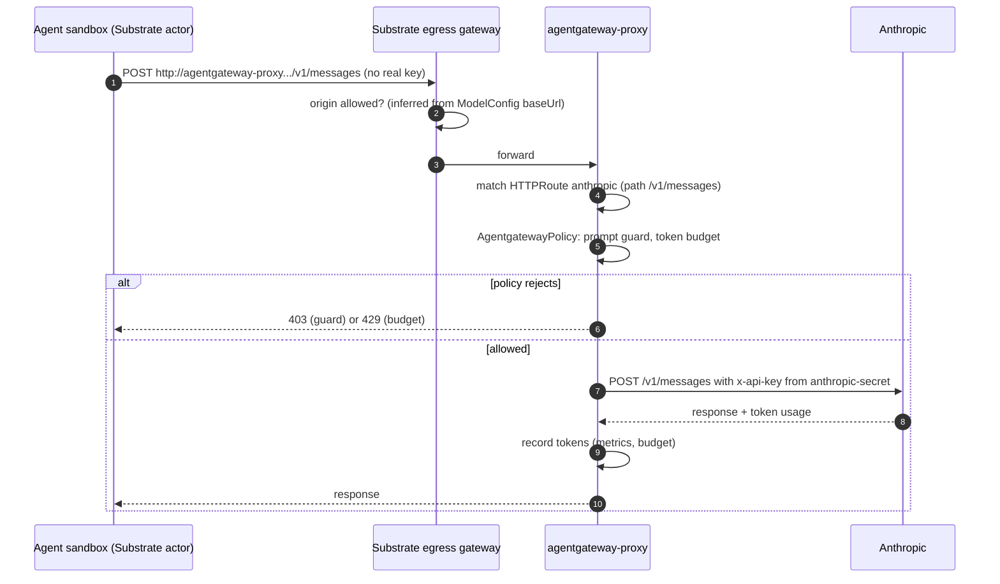

# Module 2: agentgateway in front of your agents' model calls

**Solo lab:** [Program agentgateway for LLM consumption](https://solo.io/resources/lab/program-agentgateway-for-llm-consumption).
The lab uses kgateway as the control plane. This module uses agentgateway's own charts (v1.7), which is
the current install path; the concepts (backends, routes, policies) are the same.

**Script:** `scripts/02-install-agentgateway.sh` (needs `ANTHROPIC_API_KEY` in `.env`)
**Manifests:** `manifests/lab-b/`

## Why put a gateway in front of the model?

In Module 1 every agent called Anthropic directly, with a key kagent held. That works, but nothing sits
between "agent decides to call a model" and "Anthropic bills you". agentgateway is that middle layer:

- **One key, one place.** Only agentgateway holds the provider key. kagent holds none.
- **LLM-aware policy.** It reads the request as an LLM call, not just HTTP: it can block prompts (guards),
  cap tokens (budgets), and switch or fail over between models.
- **One view of usage.** Every model call from every agent shows up in one log and one set of metrics.

How this differs from kagent's own egress gateway ([Module 1b](01b-egress.md)): Substrate's gateway decides
**whether** a sandbox may reach a host. agentgateway decides **what an LLM, MCP or agent call may contain
and how it is routed**. You use both.

## How it fits together

| Resource | API | Holds | Analogy |
|---|---|---|---|
| `Gateway` | Kubernetes Gateway API | A listener (HTTP on port 80). The controller creates the `agentgateway-proxy` pod for it | The building's front door |
| `AgentgatewayBackend` | agentgateway | Where traffic goes and how to authenticate: here, Anthropic plus the key Secret | The supplier's account |
| `HTTPRoute` | Kubernetes Gateway API | Which requests go to which backend: here, `/v1/messages` to Anthropic | The sign pointing to the right desk |
| `AgentgatewayPolicy` | agentgateway | Rules attached to a route or backend: prompt guards, token budgets | The house rules |
| `ModelConfig` (kagent) | kagent | Now points at the gateway (`anthropic.baseUrl`) and holds no key | The agent's phone number for "the model" |

The components that run them:

| Component | Namespace | Responsible for |
|---|---|---|
| agentgateway controller | `agentgateway-system` | Watches Gateways, routes, backends and policies; turns them into proxy config |
| `agentgateway-proxy` | `agentgateway-system` | The data plane: receives each call, applies policy, adds the key, forwards to Anthropic |
| Substrate egress gateway | `ate-system` | Still checks the sandbox may reach the proxy (allowed automatically, from the ModelConfig) |

### How a model call flows



In words: the sandbox calls the gateway with no real key. Substrate lets it out because the ModelConfig
names that address. agentgateway picks the route, applies its policies, adds the real key and calls
Anthropic. On the way back it records token usage.

## Step 1: Install and wire it up

```bash
./scripts/02-install-agentgateway.sh
```

What the script does, in order, and why:

1. **Gateway API CRDs (v1.6.3):** agentgateway is built on the Kubernetes Gateway API standard.
2. **agentgateway CRDs and controller (v1.7.0):** adds `AgentgatewayBackend`, `AgentgatewayPolicy` and others.
3. **`Gateway`:** the controller sees it and creates the `agentgateway-proxy` Deployment and Service.
4. **`anthropic-secret`** in `agentgateway-system`: the only place the key now lives.
5. **`AgentgatewayBackend` + `HTTPRoute`:** "send `/v1/messages` to Anthropic with this key".
6. **`ModelConfig anthropic-via-agentgateway`** and agent **`k8s-via-gateway`:** the Module 1 agent, pointed
   at the gateway.

## Step 2: Look at what was created

```bash
kubectl get pods -n agentgateway-system           # controller + agentgateway-proxy
kubectl get gateway agentgateway-proxy -n agentgateway-system   # PROGRAMMED=True
kubectl get agentgatewaybackend,httproute -n agentgateway-system
kubectl get httproute anthropic -n agentgateway-system -o yaml  # status.parents: Accepted, ResolvedRefs
kubectl get modelconfig anthropic-via-agentgateway -n kagent -o yaml
```

- **`PROGRAMMED=True`** on the Gateway: the proxy received its config.
- **HTTPRoute `status.parents`:** `Accepted` means the Gateway took the route; `ResolvedRefs` means the
  backend exists. Most routing problems show up here first.
- **The ModelConfig has no `apiKeySecret`.** Compare it with `default-model-config` from Module 1.

## Step 3: Test the gateway directly, then through an agent

Test without kagent first, so you know the gateway works:

```bash
kubectl port-forward deployment/agentgateway-proxy -n agentgateway-system 8080:80
# in another terminal:
curl -s http://localhost:8080/v1/messages \
  -H "content-type: application/json" \
  -d '{"model":"claude-haiku-4-5","max_tokens":100,
       "messages":[{"role":"user","content":"Say hello in one sentence."}]}'
```

You sent **no API key**, and Anthropic answered: agentgateway added it.

Then through the agent:

```bash
kubectl get agent k8s-via-gateway -n kagent -w          # wait for READY=True
kubectl logs -n agentgateway-system deploy/agentgateway-proxy -f
```

Chat with `k8s-via-gateway` in the dashboard. Each model call shows up in the proxy log. An agent turn
that uses tools makes several model calls: one to choose a tool, one after each tool result.

## Step 4: Add a prompt guard

```bash
kubectl apply -f manifests/lab-b/prompt-guard.yaml
```

The policy attaches to the `anthropic` route and rejects any request containing an email address or
"ignore previous instructions". Try both:

```bash
curl -s -o /dev/null -w "%{http_code}\n" http://localhost:8080/v1/messages \
  -H "content-type: application/json" \
  -d '{"model":"claude-haiku-4-5","max_tokens":50,
       "messages":[{"role":"user","content":"Email me at test@example.com"}]}'
# expect 403
```

Then ask `k8s-via-gateway` something containing an email address. The agent gets the 403 back and reports
an error. Things to notice:

- **The guard protects every agent on that route** without changing any agent.
- **By default it inspects system prompt, messages and tool output.** If a tool returns text with an email
  address, the next model call is blocked too. That is useful against data leaking out through tool
  results, and also a source of surprises.
- **`action: Mask`** would redact the match and let the call continue, instead of rejecting it.

## Step 5: Add a token budget

```bash
kubectl apply -f manifests/lab-b/token-budget.yaml
```

The budget caps the route at 2,000 tokens per minute. Chat a few times quickly, or loop the curl above:
requests start failing with **429**. Token counts are known only after a response, so the limit blocks the
next request rather than cutting one off mid-answer. Remove it with
`kubectl delete -f manifests/lab-b/token-budget.yaml`.

## Step 6: Watch token usage

```bash
kubectl port-forward deployment/agentgateway-proxy -n agentgateway-system 15020
curl -s localhost:15020/metrics | grep agentgateway_gen_ai_client_token_usage | head
```

`agentgateway_gen_ai_client_token_usage` counts input and output tokens per provider and model. This is
the basis for cost reporting; Module 5 builds on it.

## Optional: identify which agent made the call

Every call currently reaches agentgateway with the same identity. kagent can attach a short-lived,
Substrate-signed token per actor (`ModelConfig.spec.actorJwt`). agentgateway can then validate it and apply
different budgets or guards per agent (for example `rateLimit.local[].key: jwt.sub`). It's a stretch
exercise: it needs agentgateway JWT validation set up against Substrate's issuer.

## Troubleshooting

| Symptom | Likely cause | Check |
|---|---|---|
| Gateway not `PROGRAMMED` | Controller not running, or Gateway API CRDs missing | `kubectl get pods -n agentgateway-system`; `kubectl describe gateway agentgateway-proxy -n agentgateway-system` |
| curl returns 404 | Route not attached or path doesn't match | `kubectl get httproute anthropic -n agentgateway-system -o yaml` (status.parents) |
| curl returns 401 from Anthropic | Wrong key in `anthropic-secret` | Recreate the Secret; key name must be `Authorization` |
| Agent errors on every chat; nothing in the proxy log | Sandbox can't reach the proxy | `kubectl get agent k8s-via-gateway -n kagent -o yaml` conditions; confirm `baseUrl` uses the full `...svc.cluster.local` name |
| Agent works without the gateway but not with it | Request path or format differs | Watch the proxy log while chatting; compare with the curl test |
| Port 80 already in use on the node | Something else (e.g. Traefik) holds it | `kubectl get svc -A \| grep LoadBalancer` |

> **Not yet tested end to end.** The agentgateway resources follow the v1.7 docs, and the ModelConfig
> fields come from kagent 1.0's CRD. The kagent-to-agentgateway path (no key in kagent, gateway adds it)
> hasn't been run yet. If the agent fails while curl works, that hand-off is the place to look.

## References

- [agentgateway: LLM quick start](https://agentgateway.dev/docs/kubernetes/latest/quickstart/llm/)
- [agentgateway: Anthropic provider](https://agentgateway.dev/docs/kubernetes/latest/integrations/llm/providers/anthropic/)
- [agentgateway: prompt guards](https://agentgateway.dev/docs/kubernetes/latest/llm/guardrails/regex/)
- [agentgateway: rate limits](https://agentgateway.dev/docs/kubernetes/latest/llm/rate-limit/)
- [kagent: credential injection (how ModelConfig keys and endpoints become egress rules)](https://github.com/kagent-dev/kagent/blob/main/docs/architecture/credential-injection.md)
