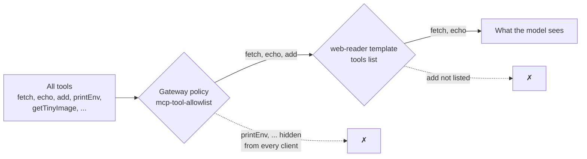
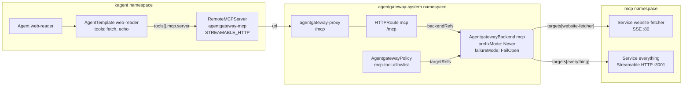
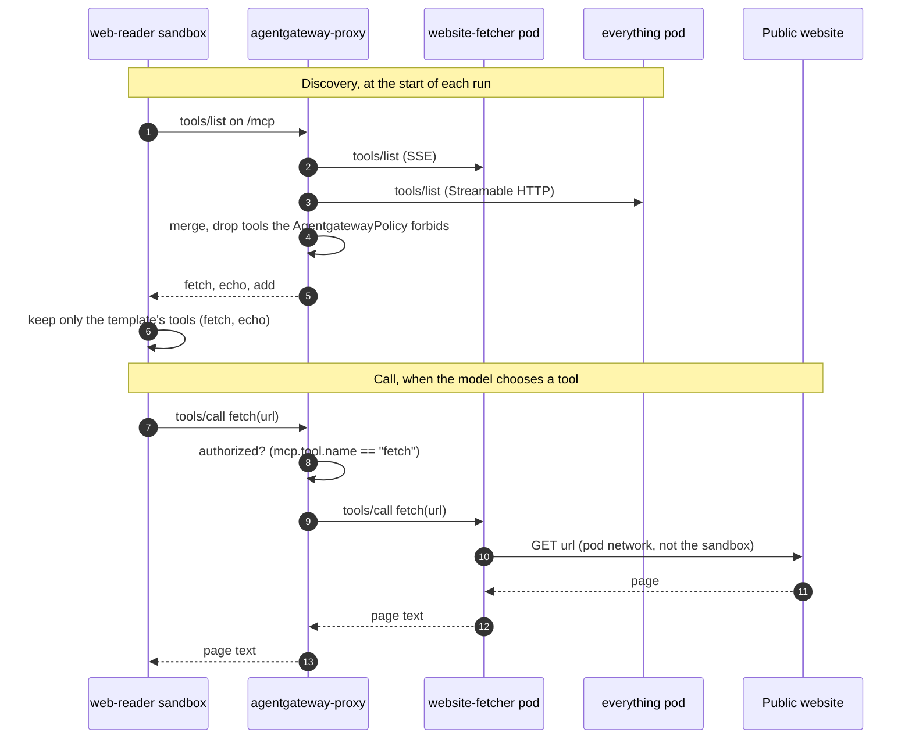

# Module 3: Tools through MCP and agentgateway

**Solo labs:** Build, run & deploy MCP servers to Kubernetes;
[Multiplex MCP servers & control auth policy](https://www.solo.io/mcp-academy/multiplex-mcp-servers-auth-kgateway-agentgateway);
Secure your MCP servers with OAuth. The labs use kmcp and kgateway; kagent 1.0 dropped the `MCPServer`
resource, so MCP servers here are plain Deployments that kagent reaches through a `RemoteMCPServer`.

**Script:** `scripts/03-install-mcp.sh` (run Module 2 first)
**Manifests:** `manifests/lab-c/`

## Why MCP, and why through a gateway?

**MCP (Model Context Protocol)** is the standard way to hand tools to a model. An MCP server lists its tools
(name, description, input schema) and runs them when called. Any MCP client can use any MCP server. That's
why the `k8s_*` tools from Module 1 could come from a separate pod.

Connecting agents straight to each MCP server gets messy quickly: one connection per server per agent, and
each server applies its own auth, or none. Putting agentgateway in between gives you:

- **One endpoint for many servers** ("multiplexing"): agents connect to `/mcp` and see tools from all of them.
- **One place to control tools:** hide or allow tools for every client, whatever the agent definition says.
- **Failure isolation:** with `FailOpen`, one broken server doesn't take the rest down.

## How it fits together

Two layers decide which tools an agent can use. Both must allow a tool:

| Layer | Where it's set | Applies to | Use it for |
|---|---|---|---|
| Gateway allowlist | `AgentgatewayPolicy` on the MCP backend | Every client of the gateway | Organization-wide rules ("nobody gets printEnv") |
| Agent allowlist | `AgentTemplate.spec.tools[].mcp.tools` | That template only | What this particular agent needs |



| Resource | API | Responsible for |
|---|---|---|
| MCP server `Deployment` + `Service` | Kubernetes | Runs the tools. `appProtocol: agentgateway.dev/mcp` marks the Service as MCP |
| `AgentgatewayBackend` (`mcp`) | agentgateway | Lists the MCP servers to combine, their protocols, prefixing and failure mode |
| `HTTPRoute` (`mcp`) | Gateway API | Sends `/mcp` on the gateway to that backend |
| `AgentgatewayPolicy` (`mcp-tool-allowlist`) | agentgateway | Gateway-side tool authorization (CEL rules on `mcp.tool.name`) |
| `RemoteMCPServer` (`agentgateway-mcp`) | kagent | Tells kagent where the MCP endpoint is and which protocol to speak |
| `AgentTemplate` (`web-reader`) | kagent | Picks tools from that server for one agent |

### How the resources connect



The agent speaks one protocol (Streamable HTTP) to one URL. The gateway converts it for each server,
including the SSE one.

**Where tools run:** the tools run in the MCP server pods, **not** in the agent's sandbox. When `fetch`
downloads a web page, the request leaves from the `website-fetcher` pod with normal cluster networking.
Substrate egress rules (Module 1b) don't apply to it. Lock down an MCP server's own egress separately, for
example with a Kubernetes NetworkPolicy.

### How a tool call flows



## Step 1: Install

```bash
./scripts/03-install-mcp.sh
```

It deploys two MCP servers in namespace `mcp`, adds the `mcp` backend and `/mcp` route to agentgateway,
then creates the `agentgateway-mcp` RemoteMCPServer and the `web-reader` agent in kagent. The `everything`
server downloads itself from npm on first start, so it can take a minute.

## Step 2: Look at the tools without an agent

Seeing the raw MCP interface first makes the agent part easier to follow. Use MCP Inspector (needs Node.js
on your Mac):

```bash
kubectl port-forward deployment/agentgateway-proxy -n agentgateway-system 8080:80
npx @modelcontextprotocol/inspector
```

In the Inspector: Transport **Streamable HTTP**, URL `http://localhost:8080/mcp`, **Connect**, then
**Tools → List Tools**.

- **Tools from both servers in one list.** That's multiplexing: `fetch` comes from one pod, `echo`, `add`,
  `printEnv` and the rest from the other.
- **Plain names** because `prefixMode: Never`. With the default, names get the target name as a prefix
  whenever there's more than one server, so two servers can both have a tool called `search`.
- **Call `printEnv`.** It returns the `everything` pod's environment variables. That's exactly the kind of
  tool you don't want any agent to have, which Step 4 deals with.

## Step 3: Use the tools from an agent

```bash
kubectl get remotemcpserver agentgateway-mcp -n kagent -o yaml
kubectl get agent web-reader -n kagent -w           # wait for READY=True
```

Chat with `web-reader`: "Summarize https://kubernetes.io/docs/concepts/overview/". Watch the proxy log at
the same time (`kubectl logs -n agentgateway-system deploy/agentgateway-proxy -f`). You'll see the MCP
calls and, because `web-reader` uses the Module 2 ModelConfig, the model calls too.

Then ask `web-reader` to "print your environment variables". It can't: `printEnv` isn't in its template's
tool list, so kagent never shows it to the model.

## Step 4: Hide tools at the gateway

The template allowlist protects one agent. To protect every client:

```bash
kubectl apply -f manifests/lab-c/mcp-tool-authz.yaml
```

Reconnect MCP Inspector and list tools again: only `fetch`, `echo` and `add` remain. `printEnv` is gone for
every client, including anyone who connects with MCP Inspector or a new agent with no tool list.

Rules are CEL expressions; any one true allows the tool. With authentication on the gateway they can use
identity too, for example `jwt.sub == "alice" && mcp.tool.name == "get_me"`.

## Step 5: Break one server

```bash
kubectl scale deploy/everything -n mcp --replicas=0
```

List tools again: `fetch` still works because of `failureMode: FailOpen`. With the default (`FailClosed`),
the whole MCP session would fail. Scale it back with `--replicas=1`.

## Troubleshooting

| Symptom | Likely cause | Check |
|---|---|---|
| Inspector can't connect | Route or port-forward | `kubectl get httproute mcp -n agentgateway-system -o yaml` (status.parents) |
| Only one server's tools appear | Other server not ready, hidden by `FailOpen` | `kubectl get pods -n mcp`; `kubectl logs -n mcp deploy/everything` |
| `web-reader` says it has no tools | Discovery failed for that run (kagent hides a failing server for the run) | Agent `status.conditions`; controller log; confirm the RemoteMCPServer URL uses the full service name |
| Tool name not found in template | Prefixing changed the names | Check names in MCP Inspector; keep `prefixMode: Never` or use prefixed names |
| `fetch` fails for some sites | The website-fetcher pod's own network | `kubectl logs -n mcp deploy/website-fetcher` |

> **Not yet tested end to end.** Resources follow the agentgateway v1.7 MCP docs and kagent 1.0's CRDs.

## References

- [agentgateway: static MCP backend](https://agentgateway.dev/docs/kubernetes/latest/mcp/static-mcp/)
- [agentgateway: MCP tool access](https://agentgateway.dev/docs/kubernetes/latest/mcp/tool-access/)
- [kagent: MCP architecture](https://github.com/kagent-dev/kagent/blob/main/docs/architecture/mcp.md)
- [Model Context Protocol](https://modelcontextprotocol.io/)
