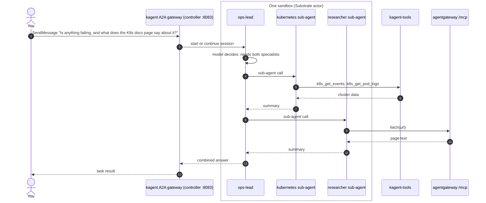

# Module 4: Agents working together (sub-agents and A2A)

**Solo labs:** Local development with kagent CLI; Build AI agents with agent skills. Both predate kagent 1.0;
this module covers the 1.0 ways agents combine.

**Manifests:** `manifests/lab-d/` (needs `k8s-readonly` from Module 1 and `web-reader` from Module 3)

## Why combine agents?

One agent with every tool gets confused and over-privileged. Small specialists with few tools each are
easier to reason about, test and secure. A coordinator then sends each question to the right specialist.
That's the pattern the built-in `platform-agent` uses.

kagent 1.0 has two different ways for agents to work together. Don't confuse them:

| | Sub-agents (shared) | A2A (agent-to-agent protocol) |
|---|---|---|
| How it's declared | `AgentTemplate.spec.tools[].subAgent.templateRef` | Every `Agent` automatically gets an A2A endpoint |
| Where it runs | Compiled **into the parent's runtime**: one sandbox, one session | Separate agent, called over the network |
| Network access | Children share the parent's egress grant | Each agent has its own |
| Who calls it | The parent model, as if it were a tool | Any A2A client: your code, another platform, the CLI |
| Status in 1.0 | Available | Endpoint available; agent-to-agent delegation through it ("dedicated" sub-agents) is deferred |

## How it fits together

| Piece | Responsible for |
|---|---|
| `ops-lead` AgentTemplate | The coordinator: a prompt about **when** to use each specialist, and no tools of its own |
| `subAgent` binding | Makes another template look like a tool to the parent: name, description ("when to route here") and template |
| `k8s-readonly`, `web-reader` | The specialists, reused unchanged from Modules 1 and 3 |
| kagent-controller A2A gateway | Serves `/agents/{namespace}/{name}` for every Agent on port 8083: agent card, send message, tasks |
| Harness | Decides how the parent and its sub-agents actually execute (kagent, Claude Code or Codex runtime) |

### How a coordinated question flows



The sub-agents run inside the parent's sandbox, so the parent's egress covers them all. Each specialist
still has only its own tools: `ops-lead` can't call `k8s_get_pod_logs` directly.

## Step 1: Build the coordinator

```bash
kubectl apply -f manifests/lab-d/platform-team.yaml
kubectl get agent ops-lead -n kagent -w        # wait for READY=True
kubectl get agenttemplate ops-lead -n kagent -o yaml
```

Read the template's `tools` list: two `subAgent` entries, no MCP servers. Each `description` is what the
coordinator's model reads to decide where to route, so write it like a job ad: what it does and what it
can't do.

## Step 2: Ask questions that need routing

In the dashboard, ask `ops-lead`:

1. "What pods are running in the kagent namespace?" → kubernetes only.
2. "Summarize https://kubernetes.io/docs/concepts/workloads/pods/" → researcher only.
3. "Are any pods restarting? Then summarize the Kubernetes docs page about pod lifecycle." → both.

Watch the controller log while you ask (`kubectl logs -n kagent deploy/kagent-controller -f`). Then try
changing a `description` to something vague and see how the routing gets worse. The descriptions are what
make routing work.

## Step 3: Talk to an agent over A2A, without the UI

Every Agent has an A2A endpoint. The UI is just one client of it.

```bash
kubectl port-forward -n kagent svc/kagent-controller 8083:8083
```

Read the **agent card**, the public description other agents and tools use to discover it:

```bash
curl -s -H 'X-User-Id: me' -H 'A2A-Version: 1.0' \
  http://localhost:8083/agents/kagent/k8s-readonly/.well-known/agent-card.json
```

Send a message (JSON-RPC):

```bash
curl -s -H 'X-User-Id: me' -H 'A2A-Version: 1.0' -H 'content-type: application/json' \
  http://localhost:8083/agents/kagent/k8s-readonly \
  -d '{"jsonrpc":"2.0","id":"1","method":"SendMessage",
       "params":{"message":{"messageId":"m1","role":"ROLE_USER",
       "parts":[{"text":"How many pods are in the kagent namespace?"}]}}}'
```

- **`X-User-Id`** identifies you. It works because kagent runs in its default `insecure` auth mode. In
  production you'd put an OIDC proxy in front and this header would be ignored.
- **The response is a task** with a `contextId`. That's the session: send it back in the next message to
  continue the same conversation.
- **The same session shows up in the UI** under that user. A2A, MCP and the UI all go through the same
  controller.

## Step 4: Same template, different runtime

```bash
kubectl apply -f manifests/lab-d/same-template-other-harness.yaml
kubectl get agent k8s-readonly-claude -n kagent -w
```

`k8s-readonly-claude` uses the same template as `k8s-readonly`, run by Claude Code (`claude-default`)
instead of kagent's runtime. Ask both the same question and compare. This is why behavior (template) and
runtime (harness) are separate resources.

## Step 5: Use the kagent CLI

```bash
kagent agent --help        # discover agents and work with their conversations
kagent session --help      # list and continue sessions
```

The CLI is another A2A client, like the curl calls above.

## Troubleshooting

| Symptom | Likely cause | Check |
|---|---|---|
| `ops-lead` not Ready, `ReferenceResolutionFailed` | A sub-agent template is missing | `kubectl get agenttemplate -n kagent`; apply Module 1 and 3 manifests first |
| Coordinator answers itself instead of routing | Vague `description`, or prompt doesn't forbid it | Tighten the descriptions and system prompt |
| curl returns 401 or 403 | Missing `X-User-Id` or `A2A-Version` header | Add both headers |
| curl returns 404 | Wrong namespace or agent name in the path | `kubectl get agents -n kagent` |
| `k8s-readonly-claude` fails to build | Harness can't use this model or template | `kubectl get agent k8s-readonly-claude -n kagent -o yaml` conditions; `kubectl get harness claude-default -n kagent -o yaml` |

> **Not yet tested end to end.** Field names follow kagent 1.0's CRDs and A2A transport docs.

## References

- [kagent: sub-agents and A2A tools](https://github.com/kagent-dev/kagent/blob/main/docs/architecture/a2a-subagents.md)
- [kagent: public A2A transports](https://github.com/kagent-dev/kagent/blob/main/docs/architecture/a2a-transports.md)
- [kagent: A2A gateway](https://github.com/kagent-dev/kagent/blob/main/docs/architecture/a2a-gateway.md)
- [A2A protocol](https://a2a-protocol.org/)
