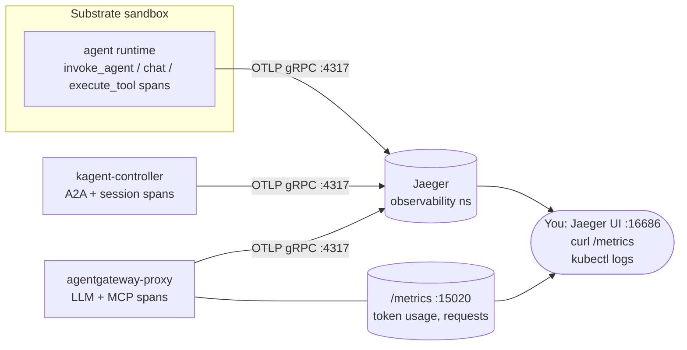

# Module 5: Seeing what your agents do (metrics, logs, traces)

**Solo lab:** [Observe Agent & MCP server interactions](https://www.solo.io/mcp-academy/observe-agent-mcp-server)
shows Solo's enterprise kagent UI. This module uses the open-source path: OpenTelemetry traces into Jaeger,
plus the metrics and logs you already have.

**Script:** `scripts/05-install-observability.sh` (run Modules 2 and 3 first)
**Manifests:** `manifests/lab-e/`

## Why it matters more for agents

A normal service does what its code says. An agent decides at run time: which tools to call, how many model
calls to make, what to pass along. When an answer is wrong, slow or expensive, you need to see what it
**decided**, not just that a request happened. One question to `ops-lead` (Module 4) can turn into a dozen
model calls and several tool calls across three components.

## The three signals

| Signal | Answers | Where it comes from here |
|---|---|---|
| **Logs** | What happened, in detail, in one component | `kubectl logs` on the controller, the proxy and MCP servers |
| **Metrics** | How much and how often, over time (tokens, requests, errors) | agentgateway `/metrics` on port 15020 |
| **Traces** | The path of **one** request across components, with timings | kagent runtimes, the kagent controller and agentgateway send spans to Jaeger |

A **trace** is one request's journey. Each step is a **span** with a start time, a duration and attributes
(model, token counts, tool name). Spans nest: an agent span contains model spans and tool spans. Every
component sends its spans to the same place using **OpenTelemetry (OTLP)**, so they can be shown together.

## How it fits together

| Component | Sends | Configured by |
|---|---|---|
| kagent agent runtime (in Substrate) | `invoke_agent`, model (`chat`) and tool (`execute_tool`) spans with `gen_ai.*` attributes | Helm `config.runtimeDefaults.telemetry.traces.endpoint` |
| kagent-controller | A2A request and session spans | Helm `config.telemetry.traces.endpoint` |
| agentgateway-proxy | A span per LLM / MCP call, with model and token counts | `AgentgatewayParameters` referenced by the Gateway |
| agentgateway-proxy | Prometheus metrics: token usage, requests | Always on, port 15020 |
| Jaeger | Stores and shows traces (UI on 16686) | `manifests/lab-e/jaeger.yaml` |

Getting traces out of the sandbox needs no egress policy: kagent adds the OTLP endpoint to each runtime's
allowed destinations automatically.

### How the signals flow



## Step 1: Install

```bash
./scripts/05-install-observability.sh
```

1. **Jaeger** in namespace `observability`: receives OTLP on 4317, UI on 16686, in-memory storage.
2. **agentgateway tracing:** `AgentgatewayParameters` tells the proxy where to send spans and which GenAI
   attributes to add. The Gateway is re-applied with `infrastructure.parametersRef`, which restarts the proxy.
3. **kagent tracing:** a `helm upgrade --reuse-values` of your existing kagent release sets the trace
   endpoint for the controller and for agent runtimes. The chart version is pinned to 1.0.1, so the upgrade
   only changes those two settings.

## Step 2: Generate some traffic

Ask `ops-lead` (Module 4) a question that uses both specialists, or ask `web-reader` to summarize a page.
Agents compile telemetry settings into their runtime, so if no runtime spans appear, restart the
controller so agents are re-prepared: `kubectl rollout restart deploy/kagent-controller -n kagent`.

## Step 3: Read a trace

```bash
kubectl port-forward -n observability svc/jaeger 16686:16686    # http://localhost:16686
```

In Jaeger, pick a service (the kagent runtime, the controller, or agentgateway) and **Find Traces**. Open
one and look at:

- **The shape:** one `invoke_agent` span containing alternating `chat` (model) and `execute_tool` spans.
  That alternation is the agent loop: think, act, read the result, think again.
- **Where the time goes:** usually model calls. A slow tool stands out as a long `execute_tool` bar.
- **Attributes on a model span:** `gen_ai.request.model`, `gen_ai.usage.input_tokens` / `output_tokens`.
  Input tokens grow with every step, because each call resends the conversation so far.
- **Agentgateway spans** for the same calls, with the gateway's view: route, model, tokens.

Message content is **not** recorded by default (`captureContent: false`), because prompts and tool results
can contain sensitive data.

## Step 4: Metrics for totals over time

Traces explain one request; metrics add up all of them.

```bash
kubectl port-forward deployment/agentgateway-proxy -n agentgateway-system 15020
curl -s localhost:15020/metrics | grep -E 'agentgateway_gen_ai_client_token_usage_(sum|count)' | head
```

The `_sum` series are total tokens by type (input/output), provider and model; `_count` is the number of
calls. Ask a few questions and run it again to watch them grow. A Prometheus server would scrape this
endpoint and keep the history; the [agentgateway OTel stack guide](https://agentgateway.dev/docs/kubernetes/latest/observability/otel-stack/)
sets one up with Grafana dashboards.

## Step 5: Logs when you need detail

```bash
kubectl logs -n kagent deploy/kagent-controller --tail=50          # sessions, revisions, errors
kubectl logs -n agentgateway-system deploy/agentgateway-proxy -f   # each LLM / MCP request, status code
kubectl logs -n mcp deploy/website-fetcher -f                      # what the tool actually did
```

A practical loop: a **metric** shows something changed (tokens doubled), a **trace** shows which request and
which step, and **logs** show the exact error.

## Troubleshooting

| Symptom | Likely cause | Check |
|---|---|---|
| No services in Jaeger | Nothing sending, or Jaeger not reachable | `kubectl get pods -n observability`; `kubectl logs -n observability deploy/jaeger` |
| agentgateway spans only | kagent runtimes not re-prepared with the new setting | `kubectl rollout restart deploy/kagent-controller -n kagent`, start a new chat |
| kagent spans only | Gateway not using the parameters | `kubectl get gateway agentgateway-proxy -n agentgateway-system -o yaml` (infrastructure.parametersRef); proxy restarted? |
| `helm upgrade` fails | Release name or chart version differs | `helm list -n kagent` |
| Traces vanish | Jaeger restarted (in-memory storage) | Expected in this lab |

> **Not yet tested end to end.** Settings follow kagent 1.0's telemetry docs and agentgateway v1.7's
> tracing guide. Jaeger listener behavior varies by version; if nothing arrives, check the Jaeger log for
> the addresses it listens on.

## References

- [kagent: telemetry](https://github.com/kagent-dev/kagent/blob/main/docs/architecture/telemetry.md)
- [agentgateway: LLM observability](https://agentgateway.dev/docs/kubernetes/latest/llm/observability/)
- [agentgateway: OTel stack](https://agentgateway.dev/docs/kubernetes/latest/observability/otel-stack/)
- [OpenTelemetry GenAI semantic conventions](https://opentelemetry.io/docs/specs/semconv/gen-ai/)
- [Jaeger](https://www.jaegertracing.io/)
